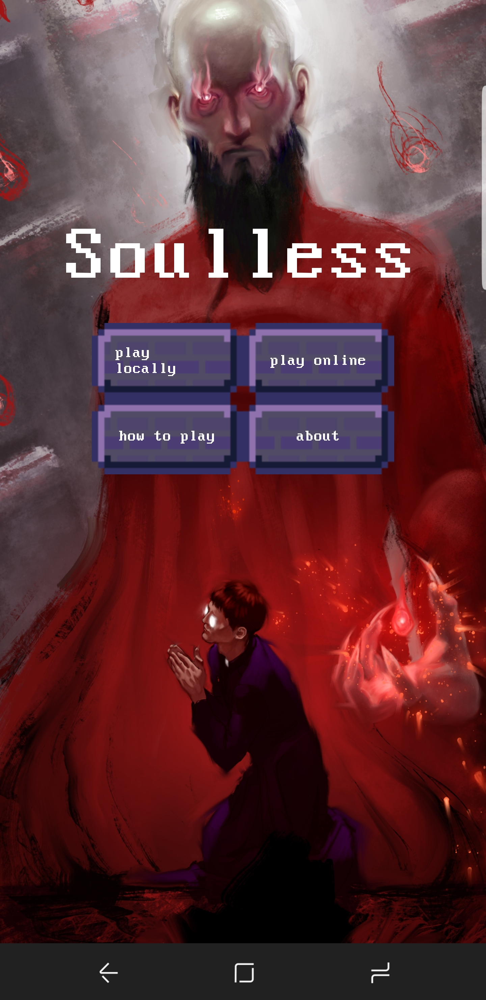
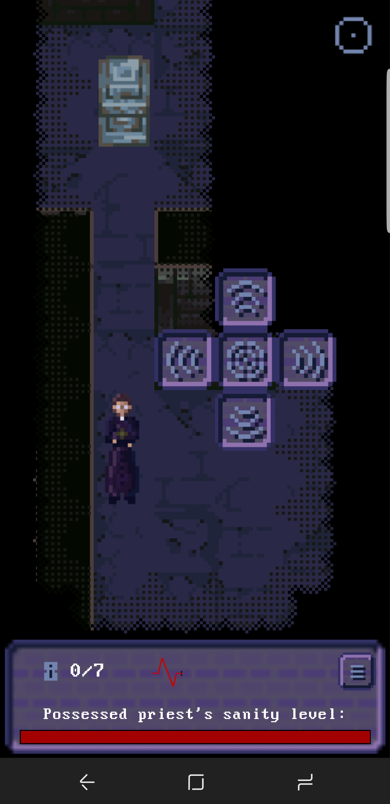
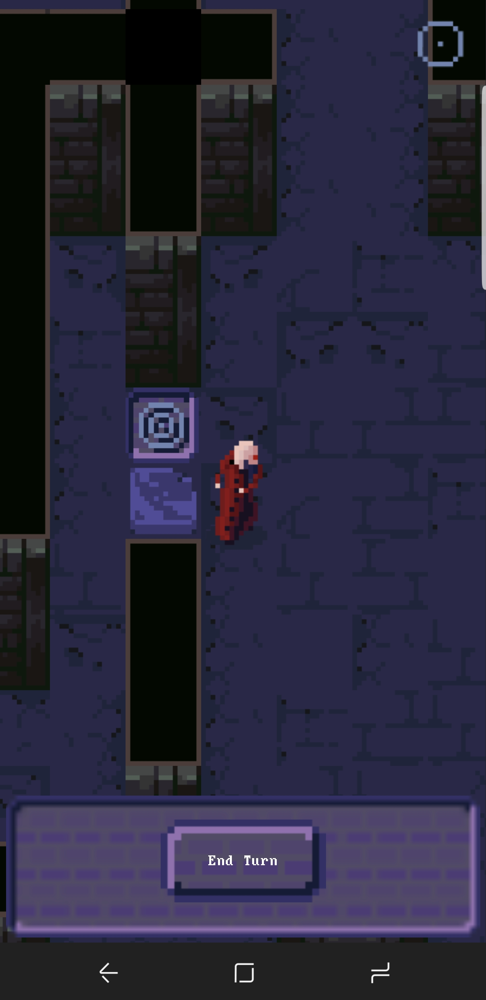
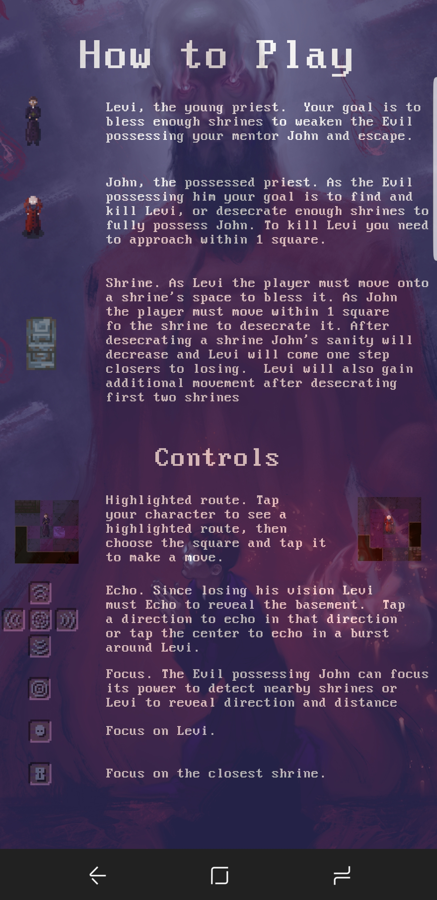
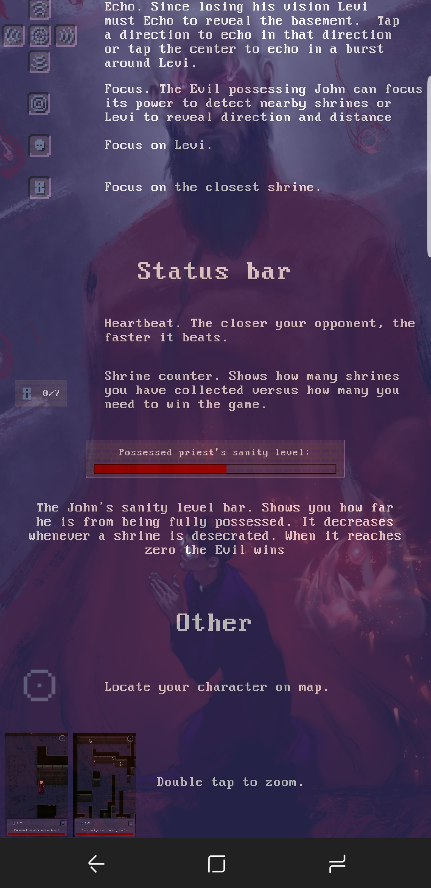

# Soulless

> A cross-platform asymmetric multiplayer mobile game built with React Native. Because sometimes possession is nine-tenths of the gameplay.

A strategic board game where two players compete with asymmetric abilities and win conditions. One player is John, an exorcist possessed by evil, while the other is Levi, his blind apprentice. Navigate a procedurally generated board to find and control shrines in this unique take on competitive mobile gaming.

## Screenshots

<p float="left">
  
  
  
</p>
<p float="left">
  
  
</p>

## Overview

Soulless is a cross-platform mobile game developed in React Native during a 7-week internship at EyeCue Lab in Portland. It showcases advanced React Native patterns, custom game engine implementation, real-time multiplayer with Socket.io, and platform-specific optimizations for iOS and Android.

## Skills Demonstrated

This project showcases mobile game development with React Native:

- **React Native Cross-Platform Development**: Single codebase targeting both iOS and Android with platform-specific files (`.ios.js` / `.android.js`) for optimized rendering, native module integration via react-native-cli, and handling platform-specific UI paradigms while maintaining shared business logic.

- **Custom 2D Game Engine**: Built-from-scratch game engine with canvas-like rendering using React Native Views, viewport management with zoom levels (64px zoomed in / 25px zoomed out), collision detection for 1600-cell grid navigation, and procedural board generation with configurable density parameters.

- **State Management with MobX**: Observable pattern for reactive game state using MobX decorators, centralized GameStore managing character position and stage coordinates, automatic component re-rendering on state mutations, and clean separation of data layer from UI components.

- **Real-Time Multiplayer**: Socket.io WebSocket integration for online multiplayer with room-based game sessions, synchronizing game state between devices, handling connection drops and reconnection logic, and supporting both local 2-player mode and remote online play.

- **Asymmetric Gameplay Design**: John (possessed exorcist) and Levi (blind apprentice) with different abilities and win conditions, shrine desecration vs blessing mechanics creating strategic tension, fog-of-war implementation for Levi's limited vision, and balanced win conditions requiring different strategic approaches.

- **Procedural Generation**: Dynamic board generation algorithm creating unique layouts each game, configurable wall density (allowedLengthOfWhiteLine parameter), ensuring balanced spawn points for both players, and shrine placement algorithm distributing 13 objectives across 40x40 grid.

- **React Navigation**: Screen routing with react-navigation v1, nested navigators for main menu and game flows, passing game state between screens, and modal overlays for game instructions and game-over states.

- **Animated UI Components**: React Native Animated API for splash screen animations, custom progress bars with react-native-progress-bar-animated, modal overlays with react-native-modal, and smooth tile map scrolling with touch gesture handling.

- **Component Architecture**: Organized component library (Button, Grid, Header, Container, Blurb), platform-specific screen implementations sharing business logic, reusable GridItem and AnimatedGridItem components, and separation of concerns with styles.js pattern.

- **Express Backend**: Node.js/Express server for Socket.io coordination, EJS templating for server-rendered pages, room management for multiplayer sessions, and RESTful endpoints for game lobbies.

## Tech Stack

### Mobile Framework
- **React Native** ^0.55.3 - Cross-platform mobile framework
- **React** 16.3.1 - UI library with component model
- **PropTypes** ^15.6.1 - Runtime type checking

### State Management
- **MobX** ^4.2.1 - Reactive state management with observables
- **MobX React** ^5.1.2 - React bindings for MobX

### Navigation & UI Components
- **React Navigation** ^1.5.11 - Routing and navigation
- **React Native Modal** ^6.0.0 - Modal overlays
- **React Native Side Menu** ^1.1.3 - Drawer navigation
- **React Native Tab View** ^1.0.2 - Tab-based navigation
- **React Native Progress Bar Animated** ^1.0.6 - Animated progress indicators
- **React Native Super Grid** ^2.3.0 - Grid layouts
- **React Native Extended Stylesheet** 0.8.0 - Enhanced styling

### Multiplayer & Networking
- **Socket.io** ^2.1.1 - Real-time bidirectional communication
- **Socket.io Client** ^2.1.1 - Client-side WebSocket integration

### Backend
- **Express** ^4.16.3 - Web server framework
- **EJS** ^2.6.1 - Template engine
- **Nodemon** ^1.17.5 - Development server with hot reload

### Game Engine
- **React Game Kit** ^1.0.6 - Game development utilities
- **Color** 2.0.0 - Color manipulation utilities

### Development Tools
- **Babel** - Decorator support with transform-decorators-legacy
- **ESLint** ^4.19.1 - Linting with Airbnb config
- **Jest** 22.4.3 - Testing framework
- **React Native CLI** - Native build tools

## Project Structure

```
Soulless/
├── app/
│   ├── screens/              # Game screens
│   │   ├── Game.ios.js       # iOS game screen
│   │   ├── Game.android.js   # Android game screen
│   │   ├── Engine.ios.js     # iOS game engine
│   │   ├── Engine.android.js # Android game engine
│   │   ├── Board.ios.js      # iOS board rendering
│   │   ├── Board.android.js  # Android board rendering
│   │   ├── Home.js           # Main menu
│   │   ├── Menu.js           # In-game menu
│   │   ├── HowTo.js          # Instructions
│   │   ├── TileMap.js        # Map visualization
│   │   ├── Waiting.js        # Multiplayer lobby
│   │   ├── GameOver.js       # End game screen
│   │   └── AnimatedSplashScreen.js
│   ├── components/           # Reusable components
│   │   ├── Button/           # Button variants
│   │   ├── Grid/             # Grid rendering
│   │   ├── Header/           # Screen headers
│   │   ├── Container/        # Layout containers
│   │   ├── GameList/         # Multiplayer game list
│   │   └── Blurb/            # Text displays
│   ├── data/                 # Game state
│   │   ├── GameStore.js      # MobX store
│   │   ├── Cell.js           # Grid cell model
│   │   └── WallTemplate.js   # Procedural generation
│   ├── Services/             # Business logic
│   │   └── BoardGenerator.js # Board generation algorithm
│   └── config/
│       └── routes.js         # Navigation config
├── android/                  # Android native code
├── ios/                      # iOS native code
├── assets/                   # Images and fonts
├── screenshots/              # App store screenshots
├── App.js                    # Root component
├── index.js                  # Entry point
└── package.json              # Dependencies
```

## Getting Started

### Prerequisites
- Node.js >= 8
- React Native CLI: `npm install -g react-native-cli`
- For iOS: Xcode >= 9.4
- For Android: Android Studio with SDK 28+

### Installation

```bash
# Clone the repository
git clone https://github.com/ashmortar/Soulless.git
cd Soulless

# Install dependencies
npm install

# Link native dependencies
react-native link
```

### Running on Device/Emulator

#### iOS
```bash
# Start Metro bundler
npm start

# In another terminal, run on iOS
react-native run-ios

# Or specific device
react-native run-ios --device "iPhone Name"
```

#### Android
```bash
# Start Metro bundler
npm start

# In another terminal, run on Android
react-native run-android

# Or specific device
adb devices  # List connected devices
react-native run-android --deviceId=DEVICE_ID
```

### Development

```bash
# Start with hot reload
npm start

# Run tests
npm test

# Lint code
npm run lint
```

## Game Mechanics

### Characters

**John (The Possessed Exorcist)**:
- Full vision of the board
- Desecrates shrines (turns them dark)
- Wins by desecrating 7 shrines
- Represents the corrupting evil force

**Levi (The Blind Apprentice)**:
- Limited vision (fog of war)
- Blesses shrines (purifies them)
- Wins by blessing 7 shrines
- Must navigate by sound and memory

### Gameplay

1. **Board Generation**: 40x40 grid (1600 cells) with procedurally generated walls
2. **Shrine Placement**: 13 shrines randomly distributed across the board
3. **Turn-Based Movement**: Players take turns navigating the grid
4. **Objective**: First to control 7 shrines wins
5. **Strategic Tension**: John's vision advantage vs Levi's blessing ability

### Game Modes

- **Local Multiplayer**: Two players on one device
- **Online Multiplayer**: Connect via Socket.io rooms
- **Single Device**: Pass-and-play mode

## Architecture Highlights

### Custom Game Engine

The game uses a custom-built 2D engine:

```javascript
// MobX observable game state
class GameStore {
  @observable characterPosition = { x: 0, y: 0 };
  @observable stageX = 0;
  @observable stageY = 0;

  setCharacterPosition(position) {
    this.characterPosition = position;
  }

  setStageX(x) {
    // Viewport bounds checking
    if (x > 0) {
      this.stageX = 0;
    } else if (x < -2048) {
      this.stageX = -2048;
    } else {
      this.stageX = x;
    }
  }
}
```

### Procedural Board Generation

Dynamic level generation creates unique games:

```javascript
// BoardGenerator.js
this.cellsInRow = 40;
this.cellsTotal = 1600;
this.cacheTotal = 13;  // Number of shrines
this.allowedLengthOfWhiteLine = 14;  // Wall density

// Generates unique 40x40 grid with balanced shrine placement
```

### Real-Time Multiplayer

Socket.io manages game synchronization:

```javascript
// Client connects to game room
socket.emit('join-room', { roomId, playerId });

// Server broadcasts game state updates
socket.on('game-state-update', (state) => {
  GameStore.updateState(state);
});
```

### Platform-Specific Optimization

Separate implementations for optimal performance:

```
app/screens/
├── Game.ios.js       # iOS-optimized rendering
├── Game.android.js   # Android-optimized rendering
├── Engine.ios.js     # iOS game loop
└── Engine.android.js # Android game loop
```

## Future Development

- [ ] Publish to Google Play Store
- [ ] Publish to Apple App Store
- [ ] Add AI opponent for single-player mode
- [ ] Implement ranked matchmaking
- [ ] Add character customization
- [ ] Create additional game modes
- [ ] Implement replay system
- [ ] Add spectator mode

## Contributing

This is a portfolio/educational project. Issues and suggestions welcome.

## License

GNU General Public License v3.0

This program is free software: you can redistribute it and/or modify it under the terms of the GNU General Public License as published by the Free Software Foundation, either version 3 of the License, or (at your option) any later version.

See [LICENSE](https://www.gnu.org/licenses/) for details.

---

**Authors:** [Aaron Ross](https://github.com/ashmortar) and [Natalia Telpukhova](https://github.com/telpuhova)

**Copyright © 2018 Aaron Ross and Natalia Telpukhova**

*Developed during a 7-week internship at EyeCue Lab in Portland, Oregon. This project explores whether React Native can deliver performant game experiences while maintaining cross-platform code sharing. It represents a deep dive into custom rendering engines, real-time networking, and asymmetric multiplayer design - all within the constraints of an intensive internship timeline.*
